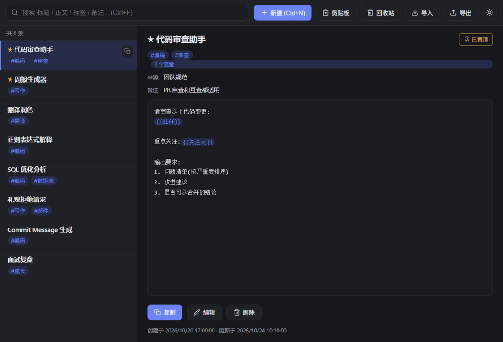
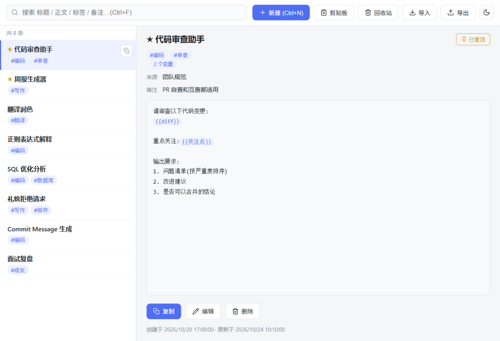
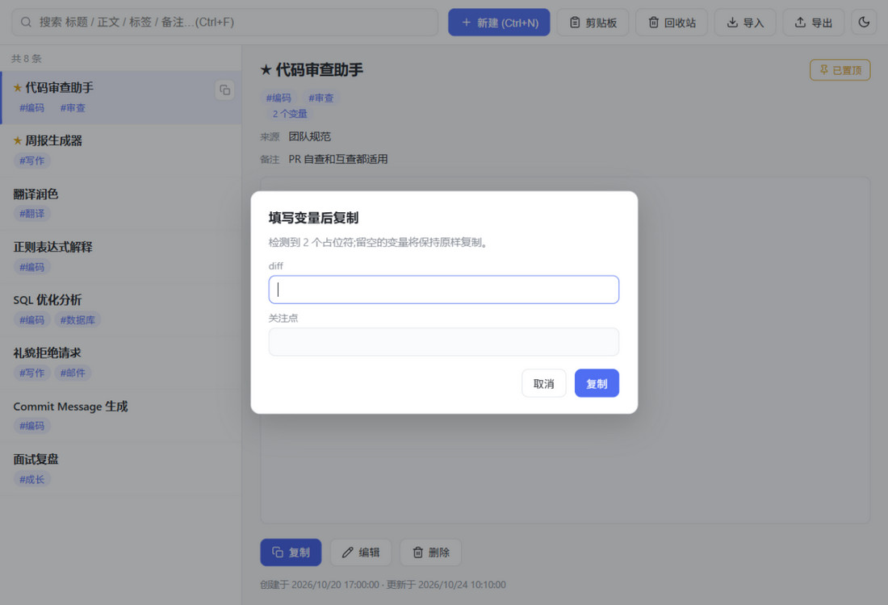
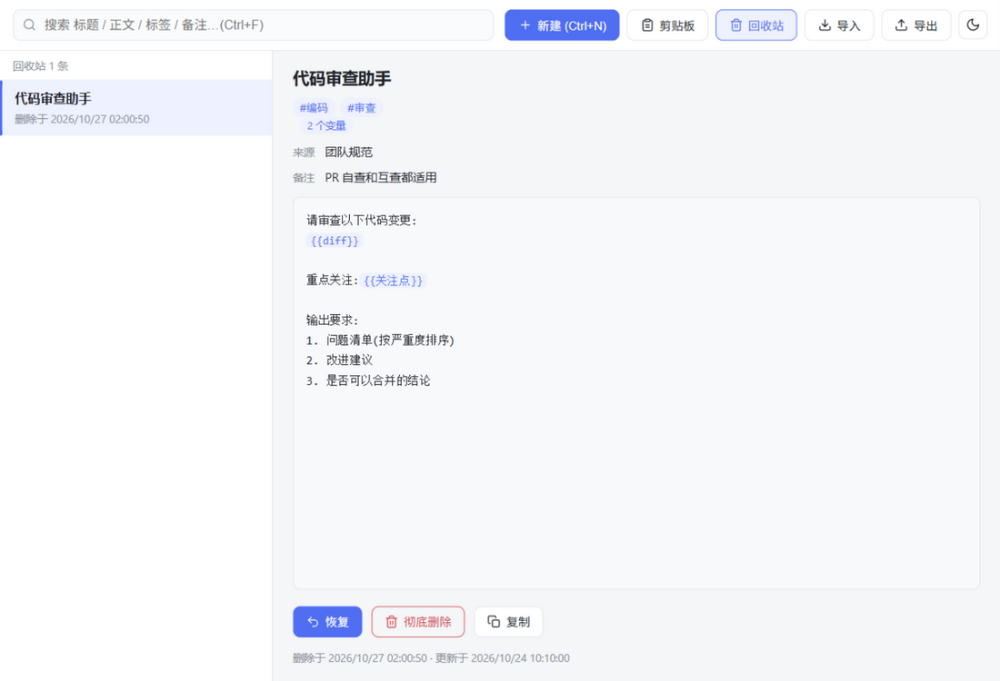
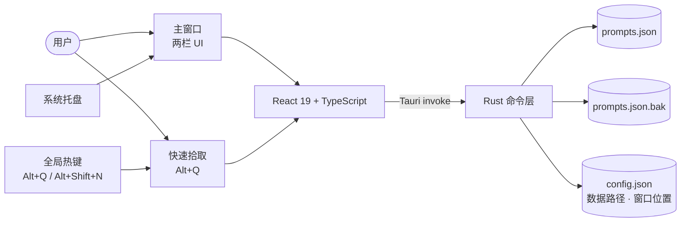

<div align="center">


# Prompt Vault

**本地优先的 Prompt 收藏工具 — 收集、检索、填空、一键复制**

<sub>Collect · Search · Fill · Copy — a local-first prompt vault for Windows.<br/>
No account, no cloud, no telemetry. Your prompts stay in a plain JSON file.</sub>

<br/>



<a href="https://tauri.app"></a> <a href="https://react.dev"></a> <a href="https://www.typescriptlang.org"></a> <a href="https://www.rust-lang.org"></a>  <a href="LICENSE"></a> 

</div>

---

## ✨ 为什么是 Prompt Vault

平时攒下的 prompt 散落在笔记、聊天记录和收藏夹里，要用时翻半天。
Prompt Vault 把它们收进一个**托盘常驻、随叫随到**的桌面工具：`Alt+Q` 唤出、输入几个字、`Enter` —— 复制走人，全程两秒。

- 🪶 **轻**：Tauri 2 原生壳，便携版单文件 ≈ 5 MB，内存占用小
- 🔒 **私**：不联网、不登录、无遥测；数据就是一个你可以随手备份的 JSON 文件
- ⚡ **快**：全局热键 + 快速拾取面板，找一条 prompt 不需要离开手头的应用
- 🧩 **巧**：`{{变量}}` 占位符在复制前弹窗填空，并记住你上次的填写

---

## 🚀 功能一览

| | 能力 | 说明 |
|---|---|---|
| 📥 | **收集** | 手动新建、`Alt+Shift+N` 剪贴板速存、导入 JSON、拖拽 `.json` 导入 / 拖文本直接新建 |
| 🔍 | **检索** | 标题/正文/标签/备注全字段即时搜索；点标签直接筛选；标签输入自动补全 |
| 🧩 | **变量占位符** | 正文写 `{{变量}}`，复制前弹窗逐个填空（同名只填一次、留空保持原样），并**记忆上次填写值**；正文中高亮显示 |
| ⚡ | **快速拾取** | `Alt+Q` 在任意界面唤出双栏面板：模糊搜索 + 命中高亮、右侧实时预览、`Tab` 直接进入编辑、复制后有确认反馈并自动隐藏 |
| 📌 | **整理** | 星标置顶、自由标签、来源与备注字段 |
| 📊 | **使用统计** | 自动记录每条 prompt 的复制次数与最近复制时间，列表可按「最近更新 / 最近复制 / 最常复制」排序 |
| 🗑 | **回收站** | 删除先进回收站可随时恢复，彻底删除才二次确认 |
| ☑️ | **批量操作** | 多选后批量加标签、批量移入回收站/恢复、批量导出所选（Ctrl/Shift 多选、Ctrl+A 全选、Esc 取消） |
| 🎨 | **体验** | 自绘标题栏、暗色/亮色主题（跟随系统）、托盘常驻、窗口位置记忆、全中文界面 |
| 💾 | **数据安全** | 单 JSON 文件 + 原子写入 + 每次写入前自动 `.bak` 备份，损坏时可一键恢复 |

---

## ⌨️ 快捷键

| 快捷键 | 作用域 | 作用 |
|---|---|---|
| `Alt+Q` | 全局 | 唤出/收起快速拾取面板 |
| `Alt+Shift+N` | 全局 | 把剪贴板内容存为新收藏 |
| `Ctrl+N` | 主窗口 | 新建 |
| `Ctrl+F` | 主窗口 | 聚焦搜索框 |
| `Ctrl+Enter` | 编辑器 | 保存 |
| `↑` `↓` / `Enter` / `Tab` / `Esc` | 快速拾取 | 选择 / 复制并关闭 / 在主窗口中编辑 / 关闭 |
| `Esc` | 弹窗 | 取消 |

> 两个全局热键可以在应用内 **设置（右上角 ⚙）** 中修改：点击输入框直接录制组合键，保存后立即生效、无需重启；若组合被其他应用占用会提示并保留旧键。

> 点窗口 ✕ = 收进系统托盘（不退出）；托盘**左键**唤出/收起，**右键菜单**可打开主窗口或真正退出。

---

## 🖼 界面一览

<div align="center">

| 亮色模式 | 暗色模式 |
|:---:|:---:|
|  |  |

| 变量填空 | 回收站 |
|:---:|:---:|
|  |  |

</div>

---

## 📦 快速开始

### 方式一：下载即用（推荐）

到 [**Releases**](../../releases) 下载任一版本：

| 文件 | 说明 |
|---|---|
| `PromptVault-0.1.0-setup.exe` | NSIS 安装包，装进系统，开始菜单可启动 |
| `PromptVault-0.1.0-portable.exe` | 单文件绿色版，放到哪都能双击运行 |

> 首次启动会让你选择一个 `prompts.json` 的保存位置（默认建议工程内 `data/` 目录），之后路径与窗口位置都会记住。
> 想备份？复制那个 JSON 文件即可；换机器？导出再导入。

### 方式二：从源码构建

前置条件：[Node.js](https://nodejs.org) 18+、[Rust](https://rustup.rs)（MSVC toolchain）、WebView2（Windows 11 自带）。

```powershell
npm install
npm run tauri build
```

产物：

- 便携版 → `src-tauri/target/release/prompt-vault.exe`
- 安装包 → `src-tauri/target/release/bundle/nsis/`

---

## 🔒 数据与隐私

- **所有数据只存在本地**：一个 JSON 文件，内容完全透明，随时可用任意编辑器查看
- **原子写入**：临时文件 `sync` 落盘后经 `MoveFileEx(REPLACE_EXISTING)` 原地替换，不存在写一半的中间态
- **自动备份**：每次写入前旧文件保存为 `prompts.json.bak`；数据解析失败时应用暂停读写，并可一键从 `.bak` 恢复
- **无网络请求**：应用不发起任何外部请求，不采集任何信息

数据文件结构：

```json
{
  "version": 1,
  "prompts": [
    {
      "id": "5d0f0f2e-…",
      "title": "代码审查助手",
      "body": "请审查以下代码变更:\n{{diff}}\n\n重点关注:{{关注点}}",
      "tags": ["编码", "审查"],
      "source": "",
      "note": "PR 自查和互查都适用",
      "pinned": true,
      "createdAt": "2026-10-20T09:00:00.000Z",
      "updatedAt": "2026-10-24T02:10:00.000Z",
      "lastValues": { "关注点": "并发安全" },
      "deletedAt": null,
      "copyCount": 12,
      "lastCopiedAt": "2026-10-27T09:12:00.000Z"
    }
  ]
}
```

---

## 🧱 技术栈与架构



```text
prompt-vault/
├─ src/                        # React 前端
│  ├─ App.tsx                  # 主窗口:两栏、搜索、回收站、导入导出
│  ├─ QuickPick.tsx            # 快速拾取面板
│  ├─ components/              # 侧栏、编辑器、弹窗、SVG 图标…
│  ├─ util.ts                  # 占位符解析、数据纠偏、合并比较
│  ├─ api.ts                   # Tauri API 封装
│  └─ App.css                  # 主题令牌(亮/暗)+ 全部样式
├─ src-tauri/
│  ├─ src/lib.rs               # 托盘、全局热键、原子写入、窗口管理
│  └─ tauri.conf.json
├─ preview/                    # 浏览器预览夹具(mock 掉 Tauri API)
└─ docs/screenshots/
```

**设计取舍**

- 数据用**单个 JSON 文件**而不是数据库：几十到几百条的规模下零运维、可读、可备份；数据量上千后再评估 SQLite + FTS5
- **不引入 Agent/UI 框架**：界面是手写 React + CSS 变量，按钮是内联 SVG 图标，构建产物小、无风格依赖
- 占位符记忆、置顶、回收站等全部落在同一个数据文件里，**无旁路状态**

---

## 🛠 开发

```powershell
npm install
npm run tauri dev      # 开发模式(热更新)
npm run tauri build    # 构建发行版

# 纯浏览器预览:mock 掉 Tauri API,改 UI 不用起 Tauri
npx vite --config preview/vite.preview.config.ts
```

- 前端严格模式 TypeScript(`tsc --noEmit` 零错误)
- 图标源图 `app-icon.png`，修改后 `npx tauri icon app-icon.png` 重新生成全套
- `preview/` 是开发预览夹具，不参与正式构建(tsconfig 只含 `src`)

---

## 🗺 路线图

- [x] 托盘常驻 + 全局快速拾取（`Alt+Q`）
- [x] 剪贴板速存（`Alt+Shift+N`）
- [x] 全局热键可配置（设置弹窗）
- [x] 占位符填空与填写记忆
- [x] 回收站 / 暗色模式 / 窗口位置记忆
- [x] 自绘标题栏
- [x] 拖拽导入（`.json` / 纯文本）
- [x] 批量操作（多选打标签、批量移入回收站/恢复、批量导出）
- [x] 使用统计（复制次数、最近复制、按使用排序）
- [ ] UI/UX 精修：QuickPick 2.0、Mica 材质、命令面板等（详见 [docs/backlog.md](docs/backlog.md)）
- [ ] 数据量过千后评估 SQLite + FTS5

---

## 🤝 贡献

欢迎 Issue 与 PR：

1. Fork 本仓库并从 `main` 切出功能分支
2. 提交前跑一遍 `npx tsc --noEmit` 与 `npm run tauri build`
3. PR 里说明改动动机与交互变化（带截图更好）

<details>
<summary><b>English</b></summary>

**Prompt Vault** is a local-first prompt manager for Windows, built with Tauri 2 + React 19 + TypeScript.

- **Collect** prompts manually, from the clipboard (`Alt+Shift+N`), or via JSON import
- **Find** them with instant full-text search, clickable tag filters, and tag autocomplete
- **Fill** `{{variables}}` in a modal before copying — values are remembered for next time
- **Copy** from a global quick-pick palette (`Alt+Q`): type, `↑↓`, `Enter` — done
- **Learn** from usage: copy counts and recent-copy timestamps, with usage-based sorting
- **Stay safe**: single JSON file, atomic writes, automatic `.bak` backups, one-click recovery
- **Feel good**: tray-resident, dark/light theme, trash bin, window-position memory, all in Chinese UI

```bash
npm install && npm run tauri build   # requires Node 18+, Rust (MSVC), WebView2
```

MIT License.

</details>

---

## 📄 许可

[MIT](LICENSE) © 2026 zklmiao

图标路径参考自 [Lucide](https://lucide.dev)（ISC License）。感谢 [Tauri](https://tauri.app)、[React](https://react.dev)、[Vite](https://vite.dev) 社区。

<div align="center"><sub>如果这个工具对你有用，欢迎点一个 ⭐</sub></div>
